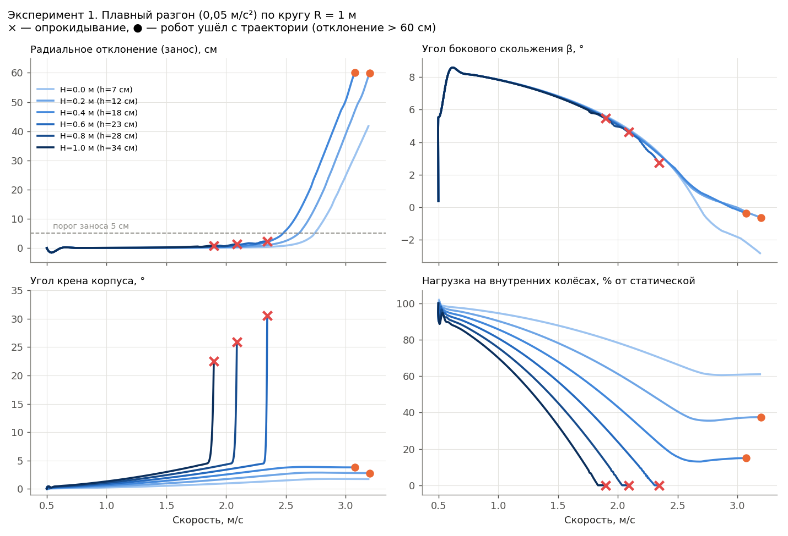
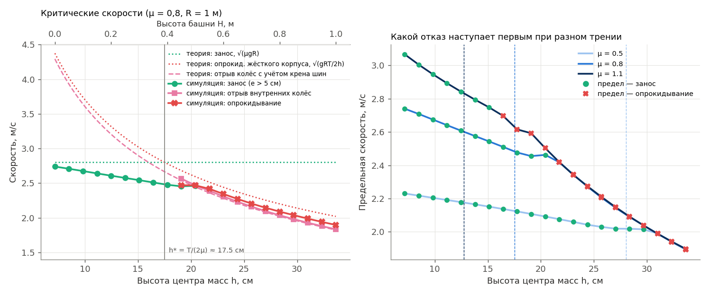
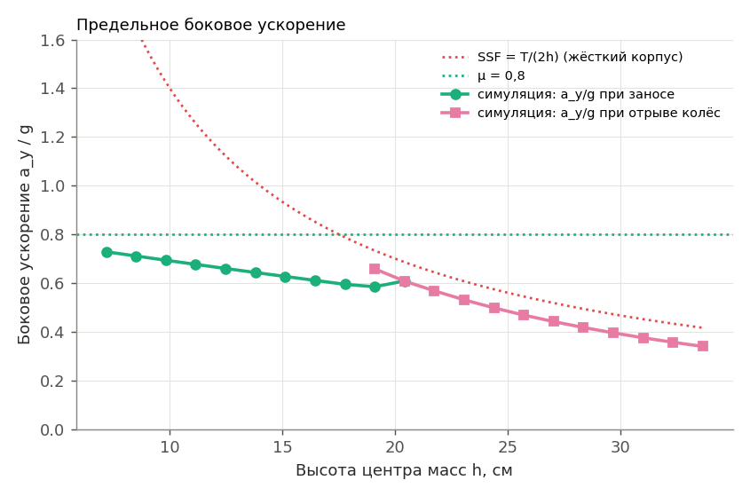
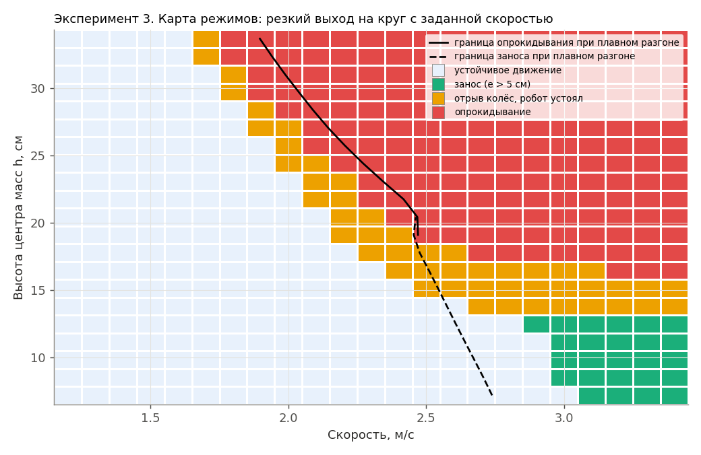
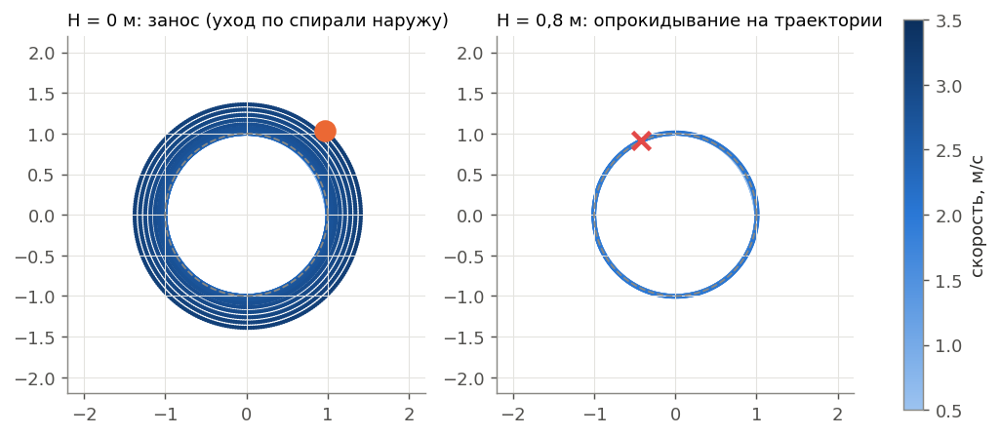

# Влияние высоты центра масс на занос и опрокидывание 4-колёсного робота

## Установка и запуск
Нужен Python 3.9+.

```bash
# 1. Скачать репозиторий
git clone https://github.com/pavelmino44/mobile_platform_sim.git
cd mobile_platform_sim

# 2. Создать виртуальное окружение
python3 -m venv .venv

# 3. Активировать его
source .venv/bin/activate          # Linux / macOS
# .venv\Scripts\activate           # Windows (PowerShell / cmd)

# 4. Установить зависимости
pip install -r requirements.txt

# 5. Запустить эксперименты (~1 мин)
python experiments.py
```
Графики сохраняются в папку `img/`, таблица результатов — в `results_table.csv`.

## Структура
```
robot_sim.py        модель робота (все параметры — в начале файла)
experiments.py      эксперименты и построение графиков
requirements.txt    зависимости
img/                графики (создаётся автоматически)
results_table.csv   критические скорости по высотам башни
```

## Модель
| Параметр | Значение |
|---|---|
| Колёсная база L / колея T | 0,30 / 0,28 м (фиксированы) |
| Масса шасси / мачты / груза на вершине | 6 / 0,5 / 2 кг (всего 8,5 кг) |
| Высота башни H → высота ЦМ h | 0…1,0 м → 7…34 см |
| Трение μ | 0,8 (доп. серия 0,5 и 1,1), слабая зависимость μ от нагрузки на колесо |
| Шины | сила увода μN·tanh(Cα/μ), эллипс трения с тяговой силой |
| Крен корпуса | жёсткость 150 Н·м/рад, демпфирование ζ = 0,3; отрыв колёс при N = 0 |
| Траектория | круг R = 1 м, передние управляемые колёса (Аккерман), привод 4WD |

Робот имеет 8 степеней свободы: плоское движение (x, y, курс, vx, vy, r) + крен (φ, φ̇).
Нормальные нагрузки на каждое колесо пересчитываются на каждом шаге по моменту крена и продольному ускорению.

Критерии:
* **занос** — радиальное отклонение от круга > 5 см;
* **отрыв колёс** — нагрузка на внутренних колёсах упала до нуля (начало опрокидывания);
* **опрокидывание** — крен превысил atan(T/2h), т.е. ЦМ вышел за линию внешних колёс.

## Эксперименты
1. **Плавный разгон** 0,5 → 4 м/с (0,05 м/с²) для H = 0…1 м — зависимость отклонения, крена,
   угла скольжения и разгрузки внутренних колёс от скорости (fig1, fig5).
2. **Критические скорости от высоты ЦМ** (21 высота, 3 значения μ) + сравнение с теорией (fig2, fig3).
3. **Карта режимов**: резкий выход на круг с постоянной скоростью, сетка 21 высота × 23 скорости
   (fig4) — проверка динамического «броска» крена.

## Графики






## Ключевые результаты (μ = 0,8)
* Два механизма потери устойчивости конкурируют. Занос наступает при a_y ≈ μg,
  опрокидывание при a_y ≈ g·T/(2h). Переход между ними происходит при **h\* = T/(2μ) ≈ 17,5 см**
  (H ≈ 0,4 м). Ниже робот уходит в занос, выше — опрокидывается. В симуляции переход
  наблюдается при h ≈ 19–20 см; в этой зоне занос и отрыв колёс наступают почти одновременно.
* **Высокий ЦМ ухудшает и занос.** Даже без опрокидывания предельное боковое ускорение
  падает с 0,73g (h = 7 см) до 0,59g (h = 19 см), потому что перенос нагрузки на внешние колёса
  снижает суммарное сцепление (трение зависит от нагрузки нелинейно). Скорость заноса снижается с 2,74 до 2,45 м/с.
* **Опрокидывание наступает раньше простой теории.** Крен на податливых шинах смещает ЦМ наружу,
  поэтому отрыв колёс происходит на 12–18 % раньше по ускорению, чем по формуле SSF = T/(2h).
  Модель с учётом крена (пунктир на fig2) совпадает с симуляцией в пределах 2 %.
* **Отрыв колёс почти сразу переходит в переворот.** При плавном разгоне от отрыва до переворота
  проходит всего 0,03–0,07 м/с, так что запаса на коррекцию практически нет.
* **Резкий вход опаснее плавного.** Из-за броска крена (колебания корпуса) колёса отрываются
  на 0,1–0,3 м/с раньше. Роботы с h ≈ 16–18 см, которые при плавном разгоне только заносит,
  при резком входе переворачиваются.
* **При большом трении переворот опаснее.** Чем выше μ, тем ниже h\*: при μ = 1,1 опрокидывание
  наблюдается уже с h ≈ 15 см (теория — 12,7 см), при μ = 0,5 — только с h ≈ 30 см (теория — 28 см). При высоком ЦМ предельная скорость
  вообще не зависит от μ: кривые сливаются в одну линию переворота.

## Ограничения
Шины без динамики (без релаксационной длины), подвеска — эквивалентная пружина по крену,
корпус жёсткий, пол ровный. Пороги 5 см отклонения и угол atan(T/2h) — условные критерии.
Качественные выводы устойчивы к этим упрощениям, точные числа — нет.
